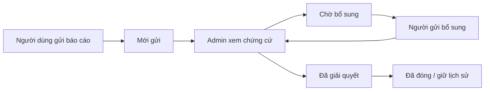

# DOC-061 · Hỗ trợ và kiểm duyệt — UI-19

React v0.13 · 27/09/2026 · Thiết kế để review, chưa production.

## Mở và thử
- Tài khoản khách/partner → Hỗ trợ và báo cáo; hoặc trong công việc → Báo cáo / nhờ hỗ trợ.
- Story `customer-support`, `partner-support`, `admin-operations-queue`.
- Vai Admin · Hỗ trợ và kiểm duyệt → mã mẫu 654321. Thanh chuyển vai chỉ dành review.
- Story admin có sẵn một hồ sơ xác minh và đánh giá minh họa; báo cáo được tạo từ phía khách/partner trong cùng lượt thử.

## Luồng hỗ trợ

Có tiêu đề, mô tả, công việc tùy chọn và tên tệp chứng cứ mẫu. Người dùng chỉ xem báo cáo do mình gửi; không chia sẻ phòng chat riêng cho admin. Công việc được chọn phải nằm trong phạm vi xem hiện hành. Admin tìm theo mã, nội dung, người gửi; lọc trạng thái và xem lịch sử phản hồi. Bổ sung khi đang chờ chuyển về Đang xem xét. Báo cáo đóng chỉ đọc; có thể tạo báo cáo mới.
Thời gian tiếp nhận 08:00–22:00 giờ Hà Nội. Gửi/đóng báo cáo không đổi hóa đơn, tiền công, point, phí, dấu thanh toán hoặc trạng thái công việc.

## Xác minh hồ sơ
Người đăng ký gửi giấy tờ → admin nhận tại Hồ sơ xác minh → Cần bổ sung / Không đạt / Đã xác minh, bắt buộc lý do. Duyệt cần đánh dấu đã đối chiếu và mã quản trị mẫu. Partner không tự bấm trạng thái được xác minh nữa. Tệp chờ duyệt được khóa sửa; bổ sung/gửi lại sau phản hồi. Danh tính đã xác minh cập nhật cờ hồ sơ công khai khi hồ sơ đó đã công bố.
Hiện mô phỏng hồ sơ đăng ký trong phiên của account mẫu (id6), chưa phải quản lý nhiều bộ giấy tờ của mọi partner; không được suy diễn đã có hệ thống KYC thật.

## Kiểm duyệt đánh giá
Hàng đợi gồm đánh giá hai chiều trên công việc đã có trong phiên. Admin Giữ trạng thái / Ẩn / Khôi phục với lý do và xác thực mẫu. Không sửa sao hoặc nội dung. Hai bên liên quan vẫn xem nội dung/kết quả quản trị trong lịch sử công việc; ẩn khỏi điểm đánh giá công khai. Đề nghị xem xét từ hai bên nối vào hàng đợi này.
Điểm công khai: khi có đánh giá công việc trong phiên, tính trên các đánh giá khách → partner không bị ẩn; nhãn “trong lượt thử”. Khi chưa có đánh giá phiên, card vẫn dùng số mẫu cũ để minh họa bố cục. Không gộp số tổng fixture 42/68 với đánh giá thật; đây chưa phải dữ liệu thống kê sản phẩm. Toàn bộ đánh giá phiên bị ẩn → không có điểm, khôi phục → tính lại.

## Nhật ký
Quyết định hỗ trợ, hồ sơ và đánh giá lưu loại, đối tượng, thời gian, nội dung và lý do trong phiên. Không có thao tác xóa/sửa nhật ký UI. Nhật ký này tách nhóm tài chính UI-18; chưa phải kho kiểm toán backend.

## QA
- 42 kiểm tra logic đạt: kiểm quyền người gửi, yêu cầu/bổ sung/đóng báo cáo, mã admin, điều kiện duyệt hồ sơ, không duyệt lại, ẩn/khôi phục điểm mà giữ invoice và sao gốc.
- Browser: báo cáo KV-001 + chứng cứ mẫu → admin yêu cầu bổ sung → khách gửi thêm → trạng thái Đang xem xét, đủ lịch sử.
- Browser: admin duyệt hồ sơ Danh tính mẫu; ẩn đánh giá 4 sao → card Nguyễn Văn Minh không còn điểm; khôi phục được.
- Sửa điểm vào công việc: quay lại hỗ trợ ưu tiên hồ sơ đã gửi, không mở nhầm form mới.
- Bố cục admin mobile 390px và desktop 1440px không tràn ngang; đã xem ảnh chi tiết mobile. Build Vite/Storybook đạt, 48 stories.

## Phần chưa làm
- Tệp mới lưu tên, không có upload hoặc xem giấy tờ/ảnh thật. Không xác thực, phân quyền server, lưu dữ liệu bền hoặc push thật; reload mất dữ liệu.
- Xử lý khoản giữ treo/đảo tiền vẫn pending; chưa nối hành động admin hoàn tất thay thợ trong React. Báo cáo không tự tạo bút toán.
- Admin quản lý nhiều tài khoản/khôi phục/khóa, đình chỉ partner, quản lý danh mục kỹ năng và báo cáo vận hành tổng còn cần chuyển sang React. Không mở chuyển chủ/đóng doanh nghiệp hoặc banner/voucher.

## Đồng bộ
DOC-050/052/053/056/057/058/059/060, PLAN-006 và README trỏ bản này. Registry v1.25, UI-UX-v0.17.zip chứa nguồn và build. BRD/FR/NFR/SRS/ERD/API/wireframe nghiệp vụ không đổi yêu cầu: đang thể hiện nghiệp vụ đã chốt bằng UI mới. Giới hạn ở các mục UI-12/14/17/18 về hỗ trợ, admin xác minh, moderation được thay bằng UI-19 trong phạm vi mô tả ở trên.

## UI-20 — cập nhật hiện hành 27/09/2026
React v0.14, UI-UX-v0.18.zip, registry v1.26. Đã bổ sung quản trị tài khoản, đình chỉ partner, danh mục và báo cáo/nhật ký vận hành. Xem [phạm vi, luồng và bằng chứng QA](admin-operations.md). Các ghi chú trước đây rằng bốn nhóm này chưa có trong React được thay bằng UI-20; không đổi nghiệp vụ hay mở các mục pending. Các lớp xác thực và dữ liệu vẫn là mô phỏng.
